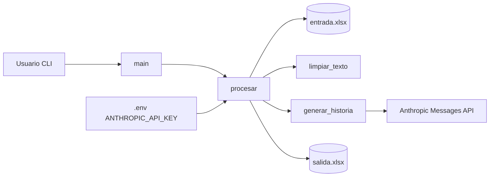
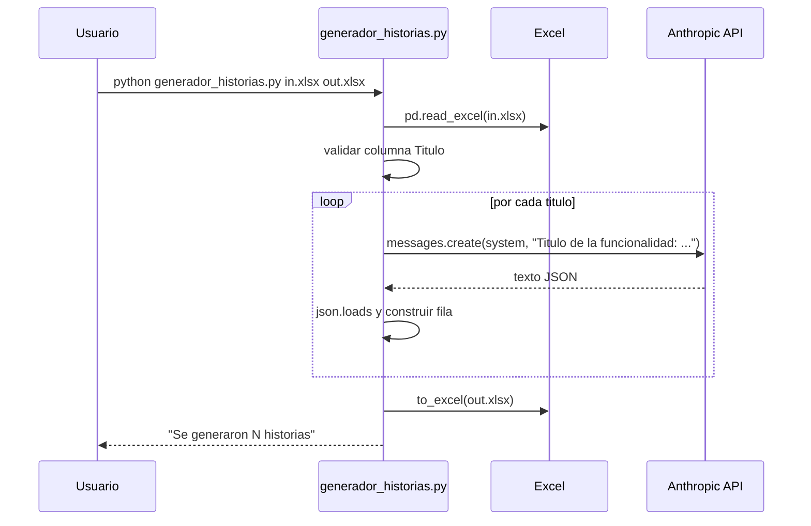

## Architecture Analysis

### System Overview
Aplicacion de un solo proceso Python: un script CLI que orquesta lectura de Excel, llamadas a la API de Anthropic y escritura de Excel. No hay servidor, base de datos ni infraestructura como codigo.

### Architectural Style
Monolitico, script batch secuencial (evidencia: un unico modulo `generador_historias.py`, funciones `limpiar_texto`, `generar_historia`, `procesar`, `main`).

### Component Relationships

Texto alternativo: el usuario ejecuta `main`, que llama a `procesar`; este lee `entrada.xlsx`, limpia cada titulo, llama a `generar_historia` (que consulta la API de Anthropic) y escribe `salida.xlsx`; la clave se carga desde `.env`.

### Data Flow
Excel -> DataFrame (pandas) -> serie de titulos sin nulos/vacios -> por titulo, prompt a Claude -> JSON `{descripcion, criterios}` -> fila `{Titulo, Descripcion, Criterios de Aceptacion}` (criterios unidos con "- " y saltos de linea) -> DataFrame -> Excel.

### Key Design Decisions
- Prompt de sistema fijo en espanol, respuesta exigida solo en JSON; se retira un posible bloque ``` con regex.
- Aislamiento de errores por fila; el mensaje queda en `Descripcion`.
- Procesamiento secuencial, una llamada por titulo.
- Credenciales via `python-dotenv`/variable de entorno.

### Improvement Opportunities
- Separar la logica de generacion (reutilizable en una Lambda) de la E/S de Excel.
- Validar el esquema de respuesta y reintentar; salida estructurada en lugar de aplanar criterios.
- Paralelismo o limites de tasa; fijar versiones de dependencias.

## Interaction Diagrams

Texto alternativo: lectura del Excel, validacion de columna, bucle de una llamada a Claude por titulo con parseo JSON, escritura del Excel y mensaje final.
