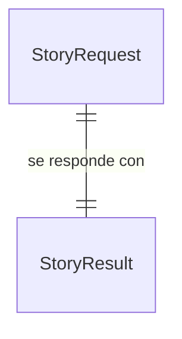

# Functional Spec — u1-walking-skeleton

Documentos de entrada: `unit-of-work.md`, `unit-of-work-story-map.md`, `stories.md`, `requirements.md`, `components.md` y `contract-summary.md`. Entidades: `entities.md`. Reglas: `rules.md`.

U1 es el esqueleto ambulante: la versión mínima que corre de principio a fin, construida primero para probar que las piezas se conectan antes de las funciones reales. Implementa parte de la historia US2.1 (generar la historia con acción y beneficio deducidos del título) con versiones mínimas de WebApp, StoryGenerator y ModelGateway.

## Qué entrega U1

- **Interfaces fijas** que usan las demás unidades: `SessionVerifier` (contrato C3) y `ModelClient` (contrato C4), tal como las define `contract-summary.md`.
- **Un modelo simulado** que implementa `ModelClient` y devuelve una respuesta fija, para probar sin llamar al modelo real.
- **Un verificador de sesión simulado** que implementa `SessionVerifier` y acepta toda solicitud (BR1.5).
- **Un servicio simulado con la forma de C1**, para que la interfaz (U5) se construya y pruebe sin el servicio completo.
- **Una versión mínima del servicio** con la operación de C1: recibe el título, llama al modelo real por `ModelClient` y devuelve el Markdown.
- **Una pantalla mínima** donde se escribe un título, se pulsa un botón y se ve el Markdown.
- **Una llamada real al modelo** en Amazon Bedrock, con el acceso que ya está habilitado en la cuenta (`delivery-planning-questions.md`, Q5).

## Workflows

### W1 — Generar una historia (camino feliz)

1. La persona escribe un título en la pantalla mínima y pulsa "Generar historia".
2. La pantalla envía el título al servicio (contrato C1).
3. El servicio verifica la sesión con el verificador simulado, que acepta (BR1.5).
4. El servicio recorta los espacios del título y comprueba que no esté vacío (BR1.3).
5. El servicio arma la petición al modelo, que pide la historia y de 2 a 3 criterios en Gherkin en español (BR1.6), y la envía por `ModelClient` (contrato C4).
6. El acceso al modelo llama al modelo y devuelve la respuesta.
7. El servicio comprueba que la historia empiece con "Como analista de negocio" (BR1.1) y la devuelve como Markdown junto con el identificador de la solicitud.
8. La pantalla muestra el Markdown tal cual.

Resultado: el Markdown que devuelve el modelo, visible en la pantalla.

### W2 — Título vacío

1. La persona pulsa "Generar historia" con el título vacío o con solo espacios.
2. El servicio no llama al modelo y devuelve el error TITLE_EMPTY (BR1.3).
3. La pantalla muestra un mensaje que pide escribir un título.

### W3 — Fallo del modelo

1. El acceso al modelo devuelve un `ModelError` (transient, timeout, unavailable o access_denied).
2. El servicio devuelve el error de contrato que corresponde a su tipo, con la indicación de si se puede reintentar (BR1.4):

| `kind` del `ModelError` | Código de error C1 | HTTP | `retryable` |
|-------------------------|--------------------|------|-------------|
| transient | MODEL_FAILURE | 502 | verdadero |
| timeout | GENERATION_TIMEOUT | 504 | verdadero |
| unavailable | MODEL_FAILURE | 502 | verdadero |
| access_denied | MODEL_FAILURE | 502 | falso |

Cambio aditivo de contrato registrado (Code Generation, Step 2): el código `RATE_LIMITED` (HTTP 429, `retryable` verdadero) se añade a C1. Lo produce solo el límite de uso de la pasarela (ráfaga 5, tasa sostenida 1 por segundo), antes de que corra el código del servicio, por lo que no lleva `requestId` y el servicio no lo emite en sus métricas (`scalability-design.md`).

3. La pantalla muestra, como texto simple, el mensaje que devuelve el servicio; el esqueleto no ofrece "Reintentar" (lo agrega u5-web-app). Un error nunca queda en silencio.

### W4 — Respuesta fuera de contrato

1. El modelo devuelve un texto que, sin espacios ni saltos de línea al inicio, no empieza con el texto exacto "Como analista de negocio".
2. El servicio devuelve el error INVALID_MODEL_RESPONSE (HTTP 502, `retryable` verdadero) y no muestra texto parcial (BR1.1).
3. La pantalla muestra, como texto simple, el mensaje que devuelve el servicio (decisión Q4).

## State machines

U1 no tiene entidades con ciclo de vida: cada solicitud se atiende y termina, sin estado guardado (`entities.md`). No hay transiciones de estado que especificar.

## Diagrama de entidades (derivado de `entities.md`)

<!-- Text fallback: cada StoryRequest se responde con exactamente un StoryResult. ModelResponse, ModelError, Session y SessionInvalid no tienen relaciones declaradas con otras entidades en entities.md; ModelResponse alimenta el contenido del StoryResult en el flujo W1, pero no es una relación de datos entre entidades. -->

## Reglas (derivado de `rules.md`)

| Regla | Qué fija |
|-------|----------|
| BR1.1 | La historia empieza con "Como analista de negocio" |
| BR1.2 | Rol, acción y beneficio relacionados con el título |
| BR1.3 | Un título vacío no se envía al modelo |
| BR1.4 | Un fallo del modelo se informa como error |
| BR1.5 | Verificador de sesión simulado solo en local y pruebas; desplegado sin verificador real, falla cerrado |

## Historias que implementa

| Historia | Parte que implementa U1 |
|----------|------------------------|
| US2.1 | La generación mínima: rol fijo, acción y beneficio relacionados con el título, y la petición de 2 a 3 criterios en español (AC2.1.1, AC2.1.2 y la petición de AC2.1.3) |

U1 no comprueba que el modelo cumpla el conteo de criterios ni el idioma, ni trata el título como dato frente a instrucciones dentro del título (AC2.1.3 completo y AC2.1.4); eso lo completa u3-story-generator.

## Cómo se comprueba que corre de punta a punta

Según la decisión de la persona (Q3 de `functional-design-questions.md`), la comprobación tiene dos partes:

- **Pruebas automáticas** con el modelo simulado, escritas antes del código (TDD), que cubren W1 a W4.
- **Un comando que ejecuta el servicio completo en local** contra el modelo real en Amazon Bedrock (Claude Sonnet, Q1), con un título de ejemplo, y verifica que devuelve un Markdown que empieza con "Como analista de negocio".

El comando concreto lo fija la persona como comando de verificación de cada punto de control; esa decisión sigue pendiente (`bolt-plan.md`).

## Dónde corre sin sesión

El contrato C1 exige una credencial de sesión. En U1 no existe inicio de sesión real, así que, para ejecuciones locales y pruebas automáticas, el verificador simulado acepta toda solicitud (BR1.5). La concesión está acotada: el verificador simulado solo se usa cuando se configura explícitamente en local o en pruebas; nunca se enlaza por defecto ni en un entorno desplegado. Un entorno desplegado sin verificador real configurado rechaza toda solicitud con el error SESSION_INVALID (falla cerrado). u4-access-control reemplaza el verificador simulado por la verificación real; hasta entonces, el esqueleto desplegado no genera historias para nadie.

## Assumptions & Open Questions

- Decidido (Q1): el esqueleto se prueba con Claude Sonnet; la elección definitiva entre Amazon Titan y Claude Sonnet se hace en u2-model-gateway.
- Supuesto: la ejecución local requiere credenciales de AWS válidas en la máquina de quien la ejecuta y acceso al modelo en us-east-1.
- Supuesto: el servicio simulado con la forma de C1 es parte de U1 para que U5 se construya en paralelo con él; lo reemplaza el servicio completo de U3.
- Abierto: la prueba de punta a punta que demuestra que el esqueleto corre; la fija el comando de verificación de la unidad, que se define en el primer punto de control.
