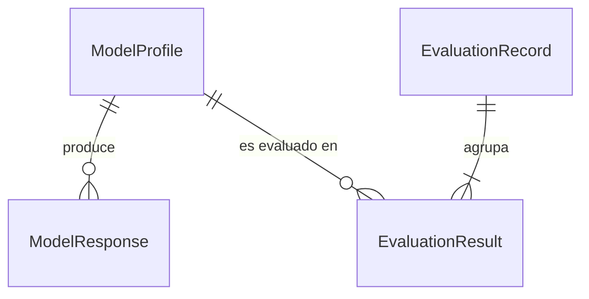

# Functional Spec — u2-model-gateway

Documentos de entrada: `unit-of-work.md`, `unit-of-work-story-map.md`, `stories.md`, `requirements.md`, `components.md` y `contract-summary.md`. Entidades: `entities.md`. Reglas: `rules.md`. Respuestas: `functional-design-questions.md` (FD Qn). Base de u1: `u1-walking-skeleton/functional-design/functional-spec.md`.

u2 completa el acceso al modelo (componente ModelGateway): elige el modelo por configuración, llama a Amazon Bedrock, traduce fallos y tiempos de espera, y evalúa Amazon Titan frente a Claude Sonnet. Implementa el contrato C4 (`ModelClient`) que u1 dejó fijado. No interpreta el contenido de la respuesta.

## Qué entrega u2

- **Acceso al modelo configurable:** el mismo `ModelClient` de C4 funciona con Claude Sonnet y con Amazon Titan; cambiar de modelo es solo configuración (BR2.1, BR2.2).
- **Traducción de fallos y tiempos de espera** a los cuatro tipos de error de C4, con mensajes propios (BR2.3 a BR2.7).
- **Evaluación de modelos:** un comando del equipo que ejecuta los 5 títulos aprobados contra cada modelo y escribe el registro (BR2.8 a BR2.10).
- **Cambios de contrato C4 (aditivos):** `timeoutSeconds` es un número (BR2.6) y `ModelError` gana el campo opcional `reason` (BR2.3); se registran en `contract-summary.md` al inicio de Code Generation de esta unidad, antes de escribir código que los use.

## Workflows

### W1 — Llamar al modelo configurado (camino feliz)

1. El servicio (u3 en su versión completa, u1 hoy) pide una llamada con una petición ya armada y un tiempo de espera en segundos.
2. El acceso al modelo usa el modelo de la configuración (BR2.1).
3. Llama a Amazon Bedrock con ese modelo.
4. Bedrock responde dentro del tiempo; el acceso devuelve `ModelResponse` con el texto tal cual y el identificador del modelo (BR2.5).

### W2 — Modelo no soportado en la configuración

1. El servicio arranca con un identificador de modelo de otro proveedor, o mal escrito.
2. El acceso rechaza la configuración al armarse, sin llamar a AWS, e informa un error de configuración que nombra el valor (BR2.2).
3. El servicio no arranca con ese acceso; no llega a una solicitud de una persona.

### W3 — Fallo del servicio del modelo

1. Bedrock devuelve un error (límite de uso, fallo interno, no disponible, acceso denegado, modelo no habilitado, petición no válida u otro).
2. El acceso lo traduce a un `ModelError` de tipo `transient`, `timeout`, `unavailable` o `access_denied` según BR2.3.
3. El mensaje es el propio del tipo, sin detalle de AWS (BR2.4).
4. El servicio decide el reintento y el código de contrato con la tabla de errores de u1 y el indicador de reintento de BR2.7.

### W4 — Tiempo de espera agotado

1. El servicio pide una llamada con un tiempo de espera de N segundos, que puede tener fracciones (BR2.6).
2. El modelo no responde en N segundos, o la lectura de red se agota.
3. El acceso devuelve `ModelError` de tipo `timeout` y no sigue esperando; no se reintenta un tiempo agotado (regla de u1).

### W5 — Evaluar Amazon Titan frente a Claude Sonnet (US7.1)

1. La persona aprueba los 5 títulos de ejemplo (BR2.9). Sin esa aprobación, la evaluación no se ejecuta.
2. El equipo ejecuta el comando de evaluación con la lista de modelos a evaluar.
3. Para cada modelo y cada título, el comando genera una historia con las mismas instrucciones del servicio y registra un `EvaluationResult` con el resultado, el tiempo y si cumple el formato automático (BR2.8). AC7.1.1.
4. Si un modelo devuelve un error con motivo `access_not_enabled` o `model_not_found`, se registra como `blocked` con ese motivo y el mensaje propio (nunca texto de AWS), queda pendiente de solicitar el acceso, no se descarta y la evaluación sigue con los demás (BR2.10). Un error `invalid_request` se registra como `failed`, no como bloqueo. AC7.1.3.
5. Al terminar, se escribe `docs/evaluacion-modelos.md` con los títulos, el resultado de cada modelo y la decisión (BR2.9). AC7.1.2.
6. La decisión se toma con la puntuación (resultados con formato correcto): si algún modelo está bloqueado, o todos, la decisión es "pendiente" y el modelo por defecto sigue en uso; si no, gana el de mayor puntuación; en un empate (incluido cero en todos) se conserva el modelo por defecto, y con cero en todos se anota que las instrucciones necesitan afinarse (BR2.8, BR2.10).

## State machines

u2 no tiene entidades con ciclo de vida: cada llamada se atiende y termina sin estado guardado. El registro de la evaluación se escribe una vez al terminar. No hay transiciones de estado que especificar.

## Diagrama de entidades (derivado de `entities.md`)

<!-- Text fallback: un ModelProfile produce muchas ModelResponse y aparece en muchos EvaluationResult; un EvaluationRecord agrupa uno o más EvaluationResult. ModelError no tiene relaciones declaradas con otras entidades en entities.md. -->

## Reglas (derivado de `rules.md`)

| Regla | Qué fija |
|-------|----------|
| BR2.1 | El modelo se elige por configuración |
| BR2.2 | Un modelo no soportado se rechaza al arrancar |
| BR2.3 | Los fallos se traducen a los cuatro tipos de error |
| BR2.4 | El mensaje de error es propio, sin detalle de AWS |
| BR2.5 | El acceso no interpreta el texto de la respuesta |
| BR2.6 | El tiempo de espera se respeta, con fracciones |
| BR2.7 | Cada error indica si reintentar sirve |
| BR2.8 | Un resultado por modelo y título; decisión por formato |
| BR2.9 | Títulos aprobados antes; registro en Markdown |
| BR2.10 | Un modelo bloqueado se registra y no se descarta |

## Historias que implementa

| Historia | Parte que implementa u2 |
|----------|------------------------|
| US7.1 | La evaluación completa (AC7.1.1, AC7.1.2, AC7.1.3) |
| US5.1 | La traducción de fallos del modelo y el indicador de reintento (AC5.1.2) y el respeto del tiempo de espera (AC5.1.4); la pantalla (AC5.1.1) es de u5-web-app y la respuesta sin estructura (AC5.1.3) es de u3-story-generator |

## Assumptions & Open Questions

- Supuesto: la evaluación reutiliza las instrucciones por defecto del servicio de u1 y no las afina; afinarlas es de u3-story-generator.
- Supuesto: los 5 títulos de ejemplo los propone el equipo y los aprueba la persona al empezar la construcción (FD Q2); su lista se anota en el registro.
- Abierto: el identificador exacto de Amazon Titan y su disponibilidad en la cuenta.
- Abierto: desempate de la decisión (se conserva el modelo por defecto del proyecto; la persona lo confirma al ver los resultados).
- Abierto, trasladado a NFR Requirements de esta unidad: los valores de tiempo de espera por modelo (pregunta abierta de C4).
