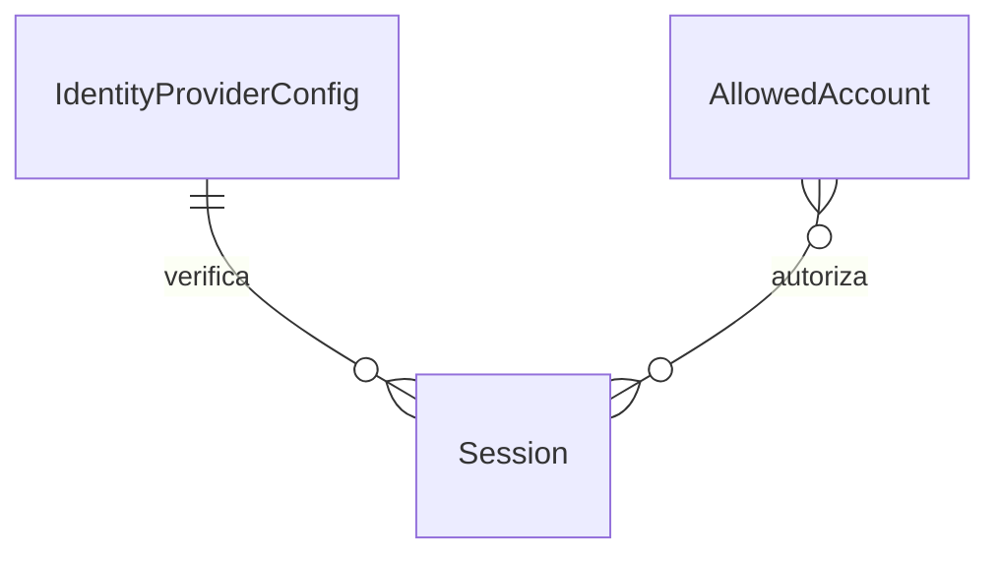

# Functional Spec — u4-access-control

Documentos de entrada: `unit-of-work.md`, `unit-of-work-story-map.md`, `stories.md`, `requirements.md`, `components.md` y `contract-summary.md`. Entidades: `entities.md`. Reglas: `rules.md`. Respuestas: `functional-design-questions.md` (FD Qn).

u4 implementa el componente AccessControl: verifica la sesión en cada solicitud de generación (contrato C3, que u3 llama) y expone la identidad y el cierre de sesión (contrato C2, que u5 usa). El inicio de sesión lo hace la pantalla con Amazon Cognito; el servicio no maneja contraseñas.

## Qué entrega u4

- Un verificador de sesión real que implementa `SessionVerifier` (C3) y reemplaza al simulado de u1 cuando la configuración real está presente (BR4.2, BR4.5).
- La lista de correos permitidos (BR4.3).
- `GET /v1/session` y `DELETE /v1/session` (contrato C2).
- Cambios aditivos de contrato: el código `ACCOUNT_NOT_ALLOWED` (403) y los motivos de `SessionInvalid`.

## Workflows

### W1 — Iniciar sesión (camino feliz)

1. La persona elige Gmail u Outlook en la pantalla de acceso (u5-web-app).
2. La pantalla la lleva a Cognito con el proveedor Google o Microsoft (BR4.1).
3. La persona completa el inicio de sesión con su proveedor y vuelve a la pantalla con un token de sesión.
4. La pantalla llega a la pantalla principal. AC6.1.1 (la pantalla principal es de u5).

### W2 — Verificar la sesión en cada solicitud

1. Llega una solicitud de generación con la credencial Bearer.
2. El verificador comprueba firma, emisor, audiencia, tipo de token y vencimiento (BR4.2) con las claves públicas del grupo (BR4.7).
3. Comprueba que el correo verificado está en la lista permitida (BR4.3).
4. Devuelve una `Session` con `sessionId`, `accountId`, `provider` y `expiresAt`, y u3 genera.

### W3 — Sin sesión o sesión inválida

1. Llega una solicitud sin credencial, con un token malformado, vencido o de otro grupo, o sin configuración del grupo de usuarios.
2. El verificador devuelve `SessionInvalid` con su motivo (BR4.2, BR4.5) y el servicio responde SESSION_INVALID (401) sin llamar al modelo.
3. La pantalla lleva a la persona a la pantalla de acceso. AC6.1.2 (la redirección es de u5).

### W4 — Cuenta que no está en la lista

1. La persona inicia sesión con una cuenta válida que no está en la lista permitida.
2. El token es válido pero el correo no está permitido (BR4.3): el servicio responde ACCOUNT_NOT_ALLOWED (403) con un mensaje claro, tanto en la generación como en `GET` y `DELETE` de `/v1/session`. Traducir `account_not_allowed` a 403 (y no a 401) cambia el mapeo que u3 hace hoy de cualquier `SessionInvalid`; es parte del cambio coordinado de C3 que hace el desarrollador de u4 al inicio de su Code Generation, volviendo a ejecutar las pruebas de u1 y u3.
3. La pantalla permanece en el acceso con el mensaje y permite elegir otra cuenta. AC6.1.3.

### W5 — Fallo del inicio de sesión

1. El proveedor o Cognito devuelve un error, o la persona cancela.
2. La pantalla permanece en la pantalla de acceso con un mensaje claro y permite elegir de nuevo (comportamiento de `wireframes.md` y `user-flow.md`, que u5 implementa). AC6.1.3.

### W6 — Cerrar la sesión

1. La persona cierra la sesión.
2. La pantalla llama a `DELETE /v1/session` (204 con sesión válida, 401 sin ella), descarta el token y termina la sesión en Cognito (BR4.6).
3. El token ya emitido es técnicamente válido hasta su vencimiento (limitación aceptada).

### W7 — Sesión vencida

1. Pasan 8 horas desde el inicio de sesión (BR4.4).
2. La siguiente solicitud falla con SESSION_INVALID y la persona inicia sesión de nuevo. Una generación en curso no se corta.

## State machines

u4 no guarda estado: la sesión es un token sin estado. El ciclo de vida lo lleva el token (emitido, vigente, vencido) y lo decide el grupo de usuarios de Cognito; el servicio no tiene transiciones propias.

## Diagrama de entidades (derivado de `entities.md`)

<!-- Text fallback: la configuración del grupo de usuarios (IdentityProviderConfig) verifica muchas Session y la lista de correos permitidos (AllowedAccount) autoriza a las cuentas de las sesiones. SessionInvalid no tiene relaciones declaradas con otras entidades en entities.md. -->

## Reglas (derivado de `rules.md`)

| Regla | Qué fija |
|-------|----------|
| BR4.1 | Inicio de sesión con Gmail u Outlook por Cognito |
| BR4.2 | Solo se acepta un token válido de este grupo |
| BR4.3 | Solo entran los correos de la lista |
| BR4.4 | Una sesión dura 8 horas |
| BR4.5 | Sin sesión válida no se genera; falla cerrado |
| BR4.6 | Cerrar la sesión descarta la credencial |
| BR4.7 | Claves públicas con copia en memoria y renovación |
| BR4.8 | Ni el correo ni el token se registran |

## Historias que implementa

| Historia | Parte que implementa u4 |
|----------|------------------------|
| US6.1 | La verificación de la sesión, la lista de cuentas permitidas y el cierre de sesión (AC6.1.1 a AC6.1.3); la pantalla de acceso y la redirección son de u5-web-app y los permisos de los proveedores son de u6-infrastructure |

## Assumptions & Open Questions

- Supuesto: u6-infrastructure crea el grupo de usuarios de Cognito, la aplicación cliente y la federación con Google y Microsoft; u4 solo verifica.
- Supuesto: los proveedores Google y Microsoft requieren que la persona registre aplicaciones en sus consolas (credenciales del cliente OAuth); eso es un paso manual de la persona y de u6.
- Abierto: la lista de correos permitidos (cuáles son).
