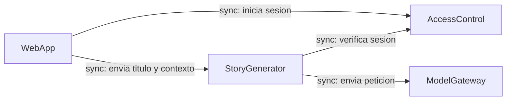

# Components — Business Analyst Agent

Documentos de entrada: `requirements.md`, `stories.md`, `architecture.md`, `component-inventory.md` y `team-practices.md`. Respuestas: `domain-design-questions.md` (DD Qn). Decisiones: `decisions.md` (ADR-NNN).

Un componente es código que se escribe; las bases de datos, colas y servicios de terceros son dependencias externas. Este documento no decide cómo se despliega nada ni qué tecnología usa cada bloque. Las entidades se capturan solo con su dueño, identificador y atributos; el esquema completo se define en Functional Design. Ninguna entidad se guarda: no hay persistencia en el MVP (`requirements.md`, NFR4), así que son datos que existen mientras dura una solicitud o una sesión.

## Catálogo de componentes

```yaml
components:
  - name: WebApp
    summary: Interfaz web con la pantalla de acceso y la pantalla principal
    behaviour: >
      Muestra S1 (acceso) y S2 (principal). Valida en pantalla que el título no esté
      vacío ni supere 200 caracteres y muestra el contador. Envía el título y el
      contexto al servicio, muestra los estados de carga, error, título ambiguo y
      resultado, ofrece las pestañas Vista previa y Markdown, copia el Markdown y
      cierra la sesión. Conserva el título escrito tras un error. No arma el
      Markdown: lo recibe ya armado del servicio.
    responsibilities:
      - Pantallas, estados y mensajes de la interfaz (US1.1, US4.1, US5.1, US6.1)
      - Validación de entrada en pantalla (límite de 200 caracteres, título vacío)
      - Inicio y cierre de sesión desde la interfaz
    depends_on:
      - component: StoryGenerator
        interaction: Envía el título y el contexto y recibe la historia en Markdown
        style: sync
      - component: AccessControl
        interaction: Inicia la sesión con Gmail u Outlook y obtiene la identidad de la sesión
        style: sync
    dependents: []
    external_dependencies: []
    entities: []

  - name: AccessControl
    summary: Identidad y sesión de la persona que usa el agente
    behaviour: >
      Gestiona el inicio de sesión con una cuenta de Gmail o de Outlook, mantiene
      la sesión y verifica que una solicitud viene de una sesión válida. Rechaza
      las solicitudes sin sesión. La regla de qué cuentas pueden entrar sigue
      abierta (requirements.md).
    responsibilities:
      - Iniciar y cerrar la sesión (FR6.1)
      - Verificar la sesión en cada solicitud de generación
    depends_on: []
    dependents:
      - component: WebApp
        interaction: Inicia la sesión y obtiene la identidad de la sesión
      - component: StoryGenerator
        interaction: Verifica que la solicitud viene de una sesión válida
    external_dependencies:
      - name: Proveedores de identidad de Google y Microsoft
        kind: third-party-api
        purpose: Autenticar a la persona con su cuenta de Gmail o de Outlook
    entities:
      - name: Session
        identifier: sessionId
        attributes: [sessionId, accountId, provider, expiresAt]

  - name: StoryGenerator
    summary: Genera la historia de usuario y sus criterios en Markdown a partir del título
    behaviour: >
      Recibe el título y el contexto, rechaza el que supere 200 caracteres o esté
      vacío, detecta el título muy corto o ambiguo y pide contexto, arma la petición
      con las instrucciones (prompt) leídas de la configuración, interpreta la
      respuesta del modelo y produce la historia con rol fijo "analista de negocio",
      2 a 3 criterios en Gherkin en español con # language: es, y el Markdown
      final. Trata el título como dato: no deja que cambie las instrucciones. Si la
      respuesta no tiene la estructura esperada, falla sin mostrar texto parcial.
      Impone el máximo de 60 segundos por historia. No guarda nada y no registra el
      contenido.
    responsibilities:
      - Reglas de entrada y de título ambiguo (FR1)
      - Armado de la petición y de las instrucciones al modelo (FR2, FR3)
      - Interpretación de la respuesta y armado del Markdown (FR2, FR3, FR4)
      - Manejo de respuestas inválidas y del tiempo máximo (FR5)
    depends_on:
      - component: AccessControl
        interaction: Verifica la sesión antes de generar
        style: sync
      - component: ModelGateway
        interaction: Envía la petición al modelo y recibe su respuesta
        style: sync
    dependents:
      - component: WebApp
        interaction: Envía el título y el contexto y recibe la historia en Markdown
    external_dependencies:
      - name: Configuración de instrucciones (prompt)
        kind: other
        purpose: Texto de las instrucciones al modelo, editable sin cambiar el código
    entities:
      - name: StoryRequest
        identifier: requestId
        attributes: [requestId, title, context]
        references:
          - entity: Session
            owned_by: AccessControl
            relationship: cada solicitud se hace dentro de una sesión
      - name: StoryResult
        identifier: requestId
        attributes: [requestId, role, action, benefit, criteria, markdown]
        references:
          - entity: StoryRequest
            owned_by: StoryGenerator
            relationship: cada resultado responde a una solicitud
      - name: PromptTemplate
        identifier: name
        attributes: [name, text, version]

  - name: ModelGateway
    summary: Acceso al modelo de IA a través de Amazon Bedrock
    behaviour: >
      Recibe una petición ya armada y devuelve la respuesta del modelo configurado.
      Permite cambiar entre Amazon Titan y Claude Sonnet sin tocar la lógica de
      generación. Traduce los fallos y tiempos de espera del servicio del modelo a
      errores propios. No interpreta el contenido de la respuesta.
    responsibilities:
      - Llamar al modelo y devolver su respuesta (FR2)
      - Seleccionar el modelo configurado (FR7.1)
      - Traducir los fallos del modelo a errores propios (FR5.2)
    depends_on: []
    dependents:
      - component: StoryGenerator
        interaction: Envía la petición al modelo y recibe su respuesta
    external_dependencies:
      - name: Amazon Bedrock
        kind: third-party-api
        purpose: Ejecutar el modelo de lenguaje (Amazon Titan o Claude Sonnet)
    entities:
      - name: ModelProfile
        identifier: modelId
        attributes: [modelId, provider, region]
```

## Component Diagram



<!-- Text fallback: WebApp llama a StoryGenerator con el título y el contexto, y a AccessControl para iniciar sesión. StoryGenerator llama a AccessControl para verificar la sesión y a ModelGateway para enviar la petición al modelo. -->

## Component Summary

| Component | Purpose | Depends On | Dependents | Entities Owned |
|-----------|---------|------------|------------|----------------|
| WebApp | Interfaz de acceso y principal | StoryGenerator, AccessControl | — | — |
| AccessControl | Identidad y sesión | — | WebApp, StoryGenerator | Session |
| StoryGenerator | Genera la historia en Markdown | AccessControl, ModelGateway | WebApp | StoryRequest, StoryResult, PromptTemplate |
| ModelGateway | Acceso al modelo de IA | — | StoryGenerator | ModelProfile |

## Entity Ownership

| Entity | Owning Component | Identifier | Attributes | References |
|--------|------------------|------------|------------|------------|
| Session | AccessControl | sessionId | sessionId, accountId, provider, expiresAt | — |
| StoryRequest | StoryGenerator | requestId | requestId, title, context | Session (AccessControl) |
| StoryResult | StoryGenerator | requestId | requestId, role, action, benefit, criteria, markdown | StoryRequest (StoryGenerator) |
| PromptTemplate | StoryGenerator | name | name, text, version | — |
| ModelProfile | ModelGateway | modelId | modelId, provider, region | — |

## External Dependencies

| Component | Dependency | Kind | Purpose |
|-----------|-----------|------|---------|
| AccessControl | Proveedores de identidad de Google y Microsoft | third-party-api | Autenticar con Gmail u Outlook |
| StoryGenerator | Configuración de instrucciones (prompt) | other | Instrucciones al modelo editables sin cambiar el código |
| ModelGateway | Amazon Bedrock | third-party-api | Ejecutar Amazon Titan o Claude Sonnet |

## Rationale

| Component | Por qué es un bloque aparte |
|-----------|----------------------------|
| WebApp | Cambia por razones de experiencia de usuario y se prueba con la interfaz; no contiene reglas de generación (ADR-005) |
| AccessControl | Concierne a la identidad y seguridad; cambia por la política de quién puede entrar, no por la generación (ADR-006) |
| StoryGenerator | Reúne las reglas del negocio de las historias; cambia al ajustar el formato, las instrucciones o las reglas del título (ADR-001, ADR-003) |
| ModelGateway | Aísla un servicio de terceros y permite cambiar entre Amazon Titan y Claude Sonnet sin tocar la generación (ADR-002) |

### Alternativas descartadas

- Dividir la generación en varios componentes (armar la petición, interpretar la respuesta y dar formato): se descartó porque la lógica es pequeña y cambia en conjunto (DD Q1; ADR-001).
- Poner el acceso al modelo dentro de la generación: se descartó porque hay que evaluar y cambiar de modelo (DD Q2; ADR-002).
- Que la interfaz arme el Markdown: se descartó por la decisión de DD Q5 (ADR-005).

## Assumptions & Open Questions

- No hay ciclos de dependencia entre componentes.
- Supuesto: el componente AccessControl abarca tanto el flujo de inicio de sesión como la verificación en el servicio; si se separa en dos, se decide en Units Generation.
- Abierto: regla de qué cuentas de Gmail u Outlook pueden entrar (`requirements.md`).
- Abierto: si la respuesta del servicio incluye también los campos de la historia por separado además del Markdown; se define en Contract Design.
- Abierto: criterio para elegir entre Amazon Titan y Claude Sonnet (`requirements.md`).
