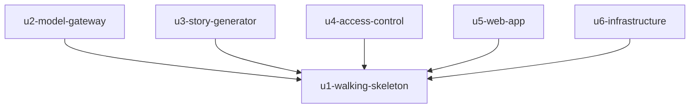

# Unit of Work Dependency — Business Analyst Agent

Documentos de entrada: `components.md`, `decisions.md`, `requirements.md` y `stories.md`. Unidades: `unit-of-work.md`. Respuestas: `units-generation-questions.md` (UG Qn).

Este documento describe solo la topología: qué unidad depende de cuál. No recomienda un orden de construcción ni identifica un camino crítico; eso lo decide Delivery Planning.

## Dependencias

Una unidad depende de otra cuando su código o sus pruebas necesitan el código de esa otra para compilar o pasar.

- U1 (u1-walking-skeleton) no depende de ninguna unidad.
- U2 (u2-model-gateway) depende de U1: amplía la versión mínima del acceso al modelo.
- U3 (u3-story-generator) depende de U1: amplía la generación mínima y se prueba con el modelo simulado que define U1.
- U4 (u4-access-control) depende de U1: usa las interfaces del servicio que fija U1.
- U5 (u5-web-app) depende de U1: amplía la pantalla mínima y usa el contrato del servicio que fija U1.
- U6 (u6-infrastructure) depende de U1: define el empaquetado y los despliegues del servicio y la interfaz que existen desde U1.

```yaml
units:
  - name: u1-walking-skeleton
    kind: service
    depends_on: []
  - name: u2-model-gateway
    kind: library
    depends_on: [u1-walking-skeleton]
  - name: u3-story-generator
    kind: service
    depends_on: [u1-walking-skeleton]
  - name: u4-access-control
    kind: service
    depends_on: [u1-walking-skeleton]
  - name: u5-web-app
    kind: ui
    depends_on: [u1-walking-skeleton]
  - name: u6-infrastructure
    kind: packaging
    depends_on: [u1-walking-skeleton]
```

## Diagrama



<!-- Text fallback: las cinco unidades u2, u3, u4, u5 y u6 dependen solo de u1-walking-skeleton; u1 no depende de ninguna; no hay ciclos. -->

## Puntos de integración entre unidades

| Entre | Punto de integración | Fuente |
|-------|----------------------|--------|
| U5 y U3 | La interfaz envía el título y el contexto al servicio y recibe el Markdown ya armado | ADR-005 |
| U5 y U4 | La interfaz inicia la sesión y obtiene la identidad | `components.md` (WebApp → AccessControl) |
| U3 y U4 | El servicio verifica la sesión antes de generar | ADR-006 |
| U3 y U2 | El servicio envía la petición al modelo a través del acceso al modelo | ADR-002 |
| U6 y las demás | La infraestructura despliega la interfaz y el servicio | UG Q3 |

Los contratos exactos de cada punto se definen en Contract Design.

## Oportunidades de desarrollo en paralelo

Una vez construida U1, las unidades U2, U3, U4, U5 y U6 no tienen dependencia entre sí, así que se pueden construir al mismo tiempo (UG Q4), cada una en su copia del proyecto. Hay varios órdenes válidos; elegir uno es decisión de Delivery Planning.

## Primera unidad como corte integrado

U1 es el corte delgado de punta a punta y es la primera unidad en el orden de dependencias. Puede correr antes que las demás porque contiene versiones mínimas de WebApp, StoryGenerator y ModelGateway y no necesita las otras cuatro unidades. La comprobación de que corre de punta a punta se define en Delivery Planning.

## Assumptions & Open Questions

- Supuesto: la verificación de sesión (U4) entra al servicio después de U1; U1 funciona sin inicio de sesión.
- Supuesto: U6 depende de U1 porque los despliegues necesitan que exista algo que desplegar; no necesita las otras unidades para empaquetar.
- Abierto: la comprobación de punta a punta de U1 (Delivery Planning).
